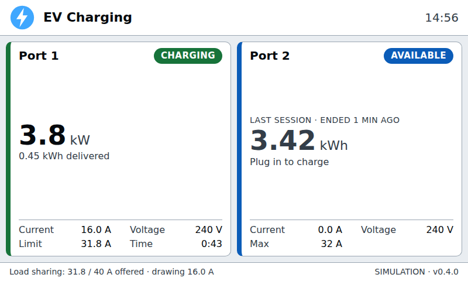

# BTCPower EVSE Controller

Replacement controller software for BTCPower J1772 EVSEs.  The example I have is model number EVP-2002-30 which has two charging ports rated at 30A each, implemented using two charging boards, a single two-channel power meter board, and a single-board x86 PC running Ubuntu 16.04.

This program is a single static Go binary that:

- talks directly to the charge control boards and power meter boards over serial,
- serves a status page for the built-in kiosk display and for network browsers,
- provides a JSON API,
- does optional load sharing,
- needs no internet access, database or OCPP server.

It supports 1–4 chargers and 0–2 meter boards.



## Build

```sh
make              # static linux/amd64 binary ./evsectl
make test
make dist         # dist/evse-controller-VERSION.tar.gz: evsectl, deploy/, README
```

`VERSION` comes from `git describe` (a `v0.4.0` tag gives `0.4.0`); override it with `make dist VERSION=0.4.0`. Without make:

```sh
CGO_ENABLED=0 GOOS=linux GOARCH=amd64 go build -trimpath -ldflags "-s -w -X main.version=0.4.0" -o evsectl ./cmd/evsectl
```

All web assets are embedded in the binary. The binary runs on the EVSE's Ubuntu 16.04.

## Try it without hardware

```sh
./evsectl -simulate -config deploy/config.example.yaml -data-dir ./data
```

Open http://localhost:8080/. In simulate mode, vehicles come and go on their own. To script them instead:

```sh
curl -XPOST localhost:8080/api/v1/sim/ports/1/manual    # stop automatic behaviour
curl -XPOST localhost:8080/api/v1/sim/ports/1/plug      # also: unplug, request, stop, fault, clear, auto
```

## Install on the EVSE

Copy the `make dist` tarball to the EVSE, then:

```sh
tar -xzf evse-controller-0.4.0.tar.gz
cd evse-controller-0.4.0
sudo deploy/install.sh
```

Without the tarball, copy `evsectl` and `deploy/` side by side and run the same script. The script:

1. Backs up root's crontab and disables the original software: cron jobs, serial daemons, apache2 and mysql. Nothing is deleted.
2. Installs `/usr/local/bin/evsectl`, `/etc/evse-controller/config.yaml` and a systemd unit running as user `evse`.
3. Points the kiosk Chrome at `http://127.0.0.1:8080/`.

Set `admin_password` in the config before using the settings page. `deploy/restore-original.sh` undoes the install.

## Web UI and API

| Path | |
|---|---|
| `/` | Status page: one card per port. Sized for the 800×480 kiosk; responsive elsewhere. |
| `/settings` | Settings, port enable/disable, logo upload, recent sessions. Needs HTTP Basic auth with `admin_password` (any user name). |
| `GET /api/v1/status` | Full status: ports, meters, load sharing. |
| `GET /api/v1/ports/{id}` | One port. |
| `POST /api/v1/ports/{id}/enable`, `/disable` | Admin. Persisted across restarts. |
| `GET /api/v1/sessions?limit=N` | Finished sessions, newest first (also stored in `data_dir/sessions.jsonl`). |
| `GET`/`PUT /api/v1/config` | Admin. Saving validates, rewrites the YAML and restarts device communication. |
| `PUT`/`DELETE /api/v1/logo` | Admin. Accepts PNG, JPEG, WebP or SVG up to 1 MB. Served at `/logo`. |

Port states are `idle`, `connected`, `charging`, `fault`, `offline` and `unknown`. The raw board state code and the full board status are included as well.

## Load sharing

**Port maximum.** Each port's `max_amps` is always enforced through the J1772 pilot duty cycle. The usable range is 20–94 % duty, i.e. 12–75 A. J1772 allows 10 % (6 A), but the boards do not: with firmware 5.09C, any duty below 20 % is reported back as 20 %.

**With `load_sharing.enabled`:**

- `system_max_amps` is divided among enabled ports with a vehicle.
- Charging vehicles share it equally. A port capped below its share passes the remainder on to the others.
- A vehicle that is connected but not requesting charge has `min_amps` reserved for it.
- Vehicles that can't be given `min_amps` are paused (charging disabled) until capacity frees up. The newest session waits first.
- An idle port stays enabled only if spare capacity covers `min_amps`. Otherwise a newly plugged vehicle is admitted only after the other ports have reduced.
- Reductions are sent immediately. Increases wait 6 s after any reduction, so vehicles have time to respond (J1772 allows 5 s) and the total offered stays within the budget.
- An offline board is assumed to keep drawing its last limit.

**`dynamic: true`** additionally needs meter channels:

- A port that draws less than its limit minus `throttle_margin_amps` for `throttle_delay_sec` is capped at its measured current plus `throttle_headroom_amps`. The freed current goes to the other ports.
- The port gets its full share back when its draw approaches the cap, and every `probe_interval_sec`.
- Ports without fresh meter data are never throttled.

## Display

`display.theme` (`dark` or `light`), `display.show_clock` and `display.show_last_session` are set in the config or on the settings page. The kiosk picks up changes on its next poll. The light theme is higher contrast for use in sunlight.

The front end must keep working on the kiosk's Chromium 62 and on Firefox 57. That rules out flexbox `gap` (use margins) and grid `gap` (use `grid-gap`), `AbortController`, and JavaScript newer than ES2016.

## Sessions

A session starts when a vehicle connects. It ends once the vehicle has been disconnected for `session_end_delay_sec` (default 10 s), and the end time recorded is the moment the vehicle left. The delay exists because boards briefly report "disconnected" when charging finishes; without it, that blip would split the session and reset its energy. Set it to 0 to end sessions immediately.

When a port has no session in progress, its card shows the previous session (unless `display.show_last_session` is false): energy delivered, or charging time if the port has no meter, and how long ago it ended. The controller computes that elapsed time, so the browser's clock doesn't matter.

Finished sessions are appended to `data_dir/sessions.jsonl`. When that file reaches 2 MB (several thousand sessions), it is renamed to `sessions.jsonl.1`, replacing any older copy.

## Logo

The logo can be uploaded on the settings page. To set it from the command line, either:

- **Copy the file into the data directory** as `logo.png`, `logo.jpg`, `logo.svg` or `logo.webp`. Remove any other `logo.*` files first; if several exist, the first in that order wins.

  ```sh
  sudo rm -f /var/lib/evse-controller/logo.*
  sudo install -m 0644 -o evse -g evse mylogo.png /var/lib/evse-controller/logo.png
  ```

  No restart is needed. The kiosk picks up the new logo on its next poll, within about a second.

- **Upload it through the API.** This checks the image type and removes old logo files for you:

  ```sh
  curl -u admin:PASSWORD -T mylogo.png http://localhost:8080/api/v1/logo
  curl -u admin:PASSWORD -X DELETE http://localhost:8080/api/v1/logo   # back to the default
  ```

Logos are shown 44 px high and up to 220 px wide. A wide image with a transparent background works best.

## Logs

The installed service writes its log to `/var/log/evse-controller/evsectl.log`. At 10 MB the file is rotated to `evsectl.log.1`, and up to 3 old files are kept, so the log never uses more than 40 MB. The limits are set by `-log-max-mb` and `-log-backups` in `deploy/evse-controller.service`. Follow the log with `tail -f /var/log/evse-controller/evsectl.log`.

Without `-log-file`, logs go to stderr, which systemd sends to the journal and Ubuntu forwards to `/var/log/syslog`. That file is rotated daily rather than by size, which is why the installed service uses `-log-file` instead. Startup errors are also printed to stderr, so `systemctl status evse-controller` still shows why the service failed to start.

## Notes

- Restarting the service, or saving settings, ends sessions in progress in the log. Charging itself continues and a new session record starts.
- The `-data-dir` and `-listen` flags override the config file. If you save settings while using them, the overridden values are written to the file.
- There is no security implemented on the web interface or API.  I would adivse against exposing this directly to the internet.

## License

GPL Version 3 or later
